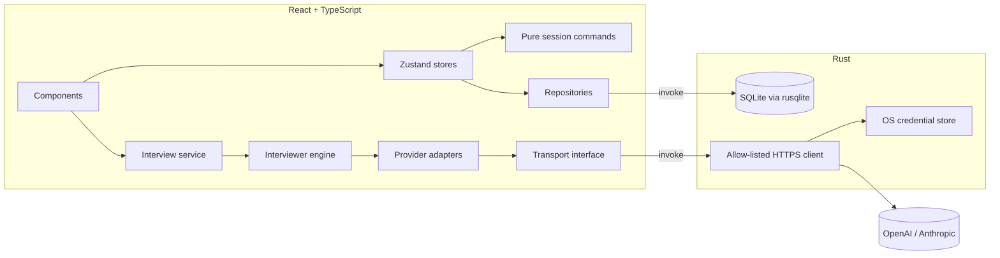

# Architecture

DesignGrill is a modular monolith: one Tauri 2 desktop app with a React frontend and a small Rust native layer. There is no hosted backend.

## Canonical model

`src/types/session.ts` defines the versioned session document (Zod schemas and types): requirements, architecture (nodes and edges), decisions, messages, reviews, findings, summaries, the pending interview question, and a review baseline. All edits go through pure functions in `src/features/interview-session/commands.ts`, applied by `useSessionStore.apply`, which handles undo/redo, dirty tracking, and autosave.

React Flow state is derived from the model by `src/features/architecture/flow-adapter.ts` and never persisted. Dragging commits positions on drag stop; deletion and connection go through commands.

`revision` increases on semantic edits (requirements, components, connections, decisions) but not on moves or chat messages.

## Persistence

The Rust layer (`src-tauri/src/db.rs`) owns SQLite. The frontend calls typed commands via `src/data/repositories`. The schema (`src-tauri/migrations/0001_init.sql`) has a table per session section with JSON payloads, plus `sessions`, `architectures`, `problems`, and `preferences`. The Rust layer checks ids, uniqueness, and size; the frontend validates shape with Zod when loading.

- Saves are a single transaction; a failed save leaves the previous state intact.
- Migrations use `PRAGMA user_version`, run in transactions, and a consistent backup (`designgrill.db.bak-vN`) is written before upgrading an existing database. A database from a newer app version is refused.
- The database lives in the platform app-data directory.
- Outside the desktop shell (`npm run dev`) an in-memory repository is used and the UI says so.

Migrations live next to the Rust code (`src-tauri/migrations`) rather than in `src/data` because only the native layer touches the database.

## AI layer

- `src/ai/provider-interface.ts`: provider-independent contract (connection test, model listing, completion, capabilities).
- `src/ai/providers/*`: provider-specific request and response shapes (OpenAI Chat Completions, Anthropic Messages). The OpenAI shape is also used for the custom provider, which targets a user-supplied base URL that the native layer validates (https, or http for localhost only). They talk to an `AiTransport`.
- `src/ai/transport.ts`: the Tauri transport calls the native `ai_http_request` command. The native side reads the API key from the credential store, fixes the host per provider, validates the path, refuses redirects, enforces size and time limits, supports cancellation, and redacts the key from responses. The key never reaches the webview.
- `src/ai/structured.ts`: validates model output with Zod, with one repair attempt; `src/ai/retry.ts` retries only transient errors, with bounded exponential backoff and jitter.
- `src/ai/prompts/*.md`: version-controlled system prompt, per-mode task prompts, and the scoring rubric.

No official Rust SDK exists for these providers and the key must stay native, so requests are built in TypeScript and sent through a small native HTTP bridge. Streaming is not implemented yet (see limitations).

## Interviewer engine

`src/features/design-review/interviewer.ts` runs one logical interviewer in distinct modes: requirements discovery, architecture interview, architecture review, failure scenario, answer evaluation, and session summary. Each turn builds a snapshot (`snapshot.ts`) from the canonical model: problem, requirements, graph, decisions, canvas drawings (`architecture/annotations.ts` turns each shape into its text plus the components it contains, connects, or sits beside), recent messages, open findings, the pending question, changes since the last review, and curated reference material. The full current graph is sent every time, which avoids stale incremental context; drag events and intermediate edits are never sent.

Review triggers are event-driven: the UI computes a debounced change summary against the baseline stored at the last review (`changes.ts`) and suggests a review when the design materially changed. Nothing calls the model automatically. A response is tagged with the revision it saw, and the UI marks it "based on an earlier version" if the design has since changed.

Findings are validated and sanitised: unknown component, connection or requirement ids are dropped. The model cannot change the design.

`src/features/interview-session/interview-service.ts` orchestrates a turn, records the candidate's answer before calling the provider so failures never lose it, and supports retry and cancellation.

## Problem library

`content/problems/<id>/` contains `problem.json`, `knowledge.md`, `reference-architectures.json`, and `scenarios.json`, loaded lazily and validated at runtime. Content is independent of application code. Reference material is passed to the model as illustrative background, never as a required solution.

## State boundaries

| Concern                                                  | Where                                        |
| -------------------------------------------------------- | -------------------------------------------- |
| Canonical document, history, save status                 | `src/store/session-store.ts`                 |
| Transient UI (view, tabs, selection, panel sizes, theme) | `src/store/ui-store.ts`                      |
| Provider settings and connection status                  | `src/features/settings/settings-store.ts`    |
| AI request state                                         | `src/features/interview-session/ai-store.ts` |
| Derived findings and change summaries                    | computed from the document                   |

## Performance baseline

No numbers are claimed yet. To measure: create a session with about 100 components and 200 connections, then record startup time, drag responsiveness, save latency (`session_save`), and idle and loaded memory in the OS activity monitor. AI latency is separate and depends on the provider.
